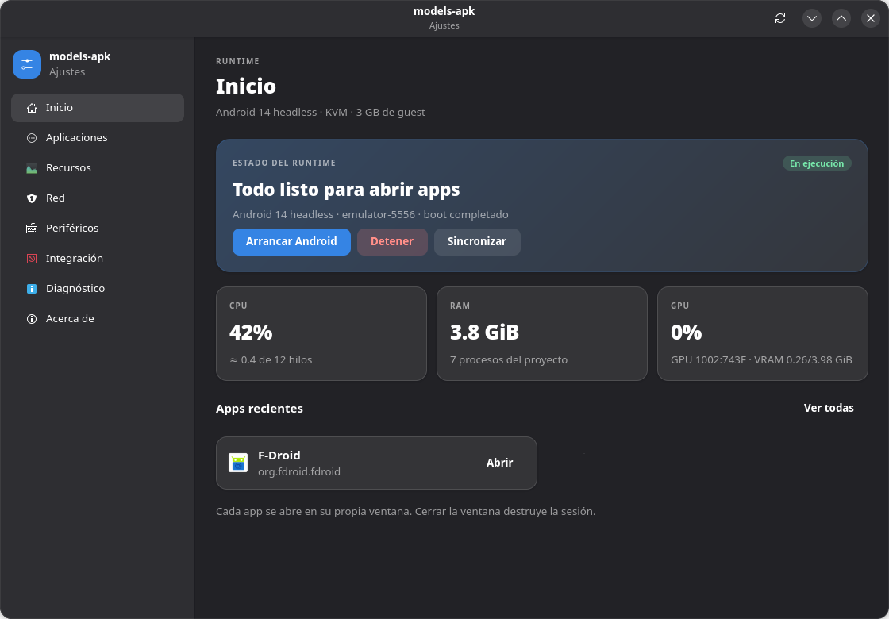
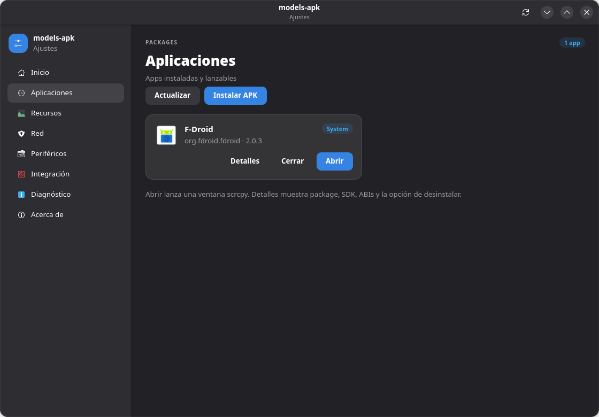
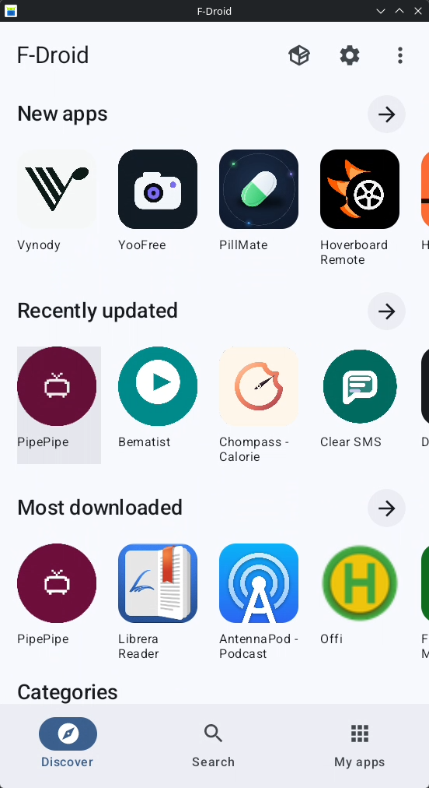
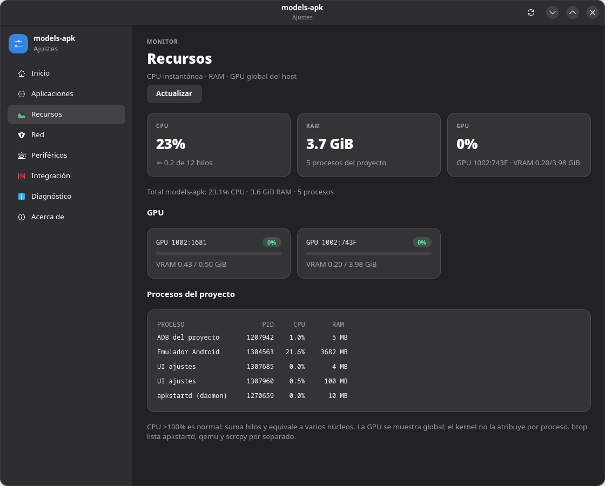
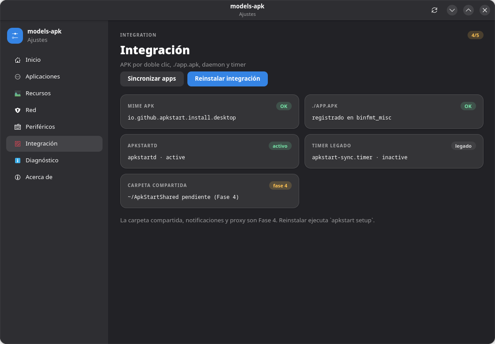
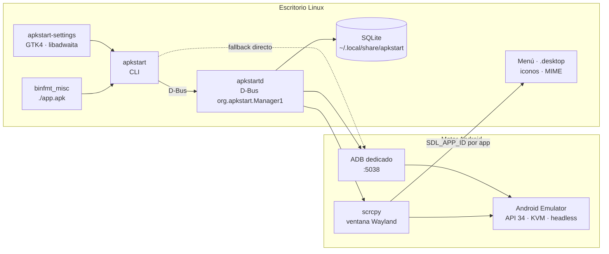

<div align="center">

# models-apk

**Tus aplicaciones Android, como aplicaciones nativas de Linux.**

Android 14 headless sobre KVM · una ventana Wayland por app · icono, menú y doble clic para instalar APK.
Sin Electron, sin Node y sin el escritorio Android.

[](LICENSE)


-3ddc84.svg)




</div>

> **Estado:** MVP funcional en desarrollo activo. Sirve para usar apps Android concretas
> (F-Droid, clientes ligeros, utilidades) en el escritorio Linux. No es un emulador para
> juegos 3D ni pretende sustituir a un teléfono.

## Qué hace

- Arranca **Android 14 (API 34) x86_64** en un emulador headless con KVM.
- Abre **cada app en su propia ventana Wayland**, con título, icono y `app_id` propios.
- Instala APK **con doble clic** desde el navegador, con `./app.apk` o desde la terminal.
- Crea la entrada `.desktop`, el icono y la **categoría freedesktop** correcta.
- Sincroniza cada 15 s las apps instaladas dentro de Android (por ejemplo desde F-Droid).
- Ofrece una UI de ajustes con estado del runtime, apps, CPU/RAM/GPU, integración y logs.

## Capturas

| Aplicaciones | Una app real en su ventana |
|---|---|
|  |  |

| Recursos | Integración |
|---|---|
|  |  |

La página **Acerca de** incluye la lista viva de lo pendiente, lo parcial y las limitaciones
conocidas del MVP.

## Requisitos

| Recurso | Mínimo | Recomendado |
|---|---|---|
| Sistema | Linux x86_64 con `/dev/kvm` accesible | Igual, con virtualización activa |
| RAM del host | **8 GB** | **12–16 GB** (guest de 3 GB + emulador + escritorio) |
| CPU | 4 hilos | 6–8 hilos |
| Disco libre | **12 GB** | 20 GB (imagen del sistema + AVD de 6 GB + APKs) |
| GPU | OpenGL 3.3 / iGPU | GPU con VA-API (mejor decodificación) |
| Sesión | Wayland | **KDE Plasma Wayland** (probado); GNOME/Hyprland pendientes |
| SDK | Android SDK + imagen API 34 `google_apis` x86_64 | Igual |
| scrcpy | 5.x | 5.0.1 o superior |
| Compilar | Rust 1.95+, GTK4 y libadwaita | Igual |

Consumo medido en el host de desarrollo: guest de **3 GB**, emulador de **2,3–3,8 GiB RSS**,
scrcpy de **100–150 MiB** y **0,2–1,5 núcleos** según uso. El arranque con quickboot tarda
unos **10–20 s**; el primero en frío, **1–2 min**.

## Instalación

### Paquetes de distro (Fase 2 — aún no publicados)

El objetivo es publicar en GitHub Releases:

```bash
# Debian / Ubuntu / derivados
sudo apt install ./models-apk_*_amd64.deb

# Fedora / RHEL / derivados
sudo dnf install ./models-apk-*.x86_64.rpm

# Arch Linux / derivados
sudo pacman -U models-apk-*.pkg.tar.zst

# Instalador universal
curl -fsSL https://raw.githubusercontent.com/Omegaiso/models-apk/main/install.sh | sh
```

> Estos comandos todavía no funcionan: los paquetes y el script `install.sh` llegan con la
> Fase 2. La instalación desde el código de abajo sí está disponible hoy.

### Desde el código (hoy)

```bash
git clone https://github.com/Omegaiso/models-apk.git
cd models-apk

# Dependencias de compilación
# Arch:            sudo pacman -S --needed base-devel rust gtk4 libadwaita
# Debian/Ubuntu:   sudo apt install build-essential pkg-config libgtk-4-dev libadwaita-1-dev
# Fedora:          sudo dnf install gcc pkgconf-pkg-config gtk4-devel libadwaita-devel

cargo build --release --locked
sudo packaging/install.sh        # instala binarios, .desktop y binfmt_misc
apkstart setup                   # integración del usuario actual (MIME + daemon)
apkstart doctor                  # comprueba KVM, SDK, AVD, scrcpy y Wayland
```

`packaging/install.sh` registra **automáticamente** `binfmt_misc` para que `./app.apk`
funcione; no hace falta pedirle al usuario un comando manual.

<details>
<summary><b>Preparar el SDK y el AVD (solo la primera vez)</b></summary>

```bash
export ANDROID_SDK_ROOT="$HOME/Android/Sdk"
# cmdline-tools y sdkmanager deben estar instalados en $ANDROID_SDK_ROOT/cmdline-tools/latest
sdkmanager --install \
  "platform-tools" "emulator" \
  "system-images;android-34;google_apis;x86_64"

avdmanager create avd \
  -n apkstart \
  -k "system-images;android-34;google_apis;x86_64" \
  -d pixel_7
```

Revisa `~/.android/avd/apkstart.avd/config.ini`:

```ini
hw.ramSize=3072
hw.cpu.ncore=4
hw.gpu.enabled=yes
hw.gpu.mode=host
disk.dataPartition.size=6G
userdata.useQcow2=yes
```

**Elimina** `disk.dataPartition.path=<temp>` si aparece: con esa línea los APK desaparecen
al reiniciar el emulador. `apkstart doctor` avisa de este problema.

Instala `scrcpy` 5.x desde tu distro o en `~/.local/opt/scrcpy`; si no está en `PATH`:

```bash
export APKSTART_SCRCPY="$HOME/.local/opt/scrcpy/usr/bin/scrcpy"
export APKSTART_SCRCPY_SERVER="$HOME/.local/opt/scrcpy/usr/share/scrcpy/scrcpy-server"
```

</details>

## Uso rápido

```bash
apkstart runtime start                 # arranca Android headless
apkstart install --launch app.apk      # instala y abre la app
apkstart launch org.fdroid.fdroid      # abre una app ya instalada
apkstart stop org.fdroid.fdroid        # cierra su ventana
apkstart sync                          # trae apps instaladas dentro de Android
apkstart-settings                      # UI de ajustes
apkstart doctor                        # diagnóstico
```

También puedes hacer doble clic en un `.apk` descargado, ejecutar `./app.apk` o abrir la app
desde el menú de aplicaciones como cualquier programa de Linux.

## Cómo funciona



- El **CLI** habla con `apkstartd` por D-Bus; si el daemon no está, cae al modo directo.
- El **daemon** es el dueño de las sesiones scrcpy, el runtime y la sincronización cada 15 s.
- **scrcpy** crea un display virtual de **552×984 a 215 dpi (411 dp)** y lo redimensiona con
  la ventana (`--flex-display`). El dpi queda fijo: al agrandar la ventana hay más columnas,
  no zoom.
- `SDL_APP_ID=io.github.apkstart.<package>` da a cada ventana su propia identidad Wayland,
  para que el compositor asocie icono, menú y agrupación.

Más detalle técnico: [arquitectura](docs/arquitectura.md) ·
[estructura](docs/estructura.md) · [dependencias](docs/dependencias.md).

## Problemas frecuentes

| Síntoma | Causa probable | Solución |
|---|---|---|
| `no se puede abrir /dev/kvm` | Usuario sin permiso sobre KVM | `sudo usermod -aG kvm $USER`, cerrar sesión y volver a entrar |
| `falta el AVD apkstart` | SDK/AVD sin preparar | Sigue el bloque “Preparar el SDK y el AVD” |
| `no se encontró scrcpy` | scrcpy fuera de `PATH` | Instálalo o define `APKSTART_SCRCPY` y `APKSTART_SCRCPY_SERVER` |
| Los APK desaparecen al reiniciar | Partición de datos temporal | Quita `disk.dataPartition.path=<temp>` del `config.ini` |
| La ventana de una app aparece **negra** | Carrera del display virtual / app ya en un display destruido (bug abierto) | Cierra la ventana y vuelve a abrirla; ver [bugs](docs/bugs.md#ventana-negra-al-abrir-una-app) |
| `./app.apk` da permiso denegado | `binfmt_misc` sin registrar | Ejecuta `sudo packaging/install.sh` o `apkstart setup` |
| No hay audio | PipeWire/PulseAudio o sesión sin audio | Comprueba `doctor`; prueba con otra app |
| Snapshot de arranque corrupto | Quickboot inválido | `APKSTART_COLD_BOOT=1 apkstart runtime start` |

Guía ampliada: [instalación y errores](docs/instalacion.md).

## Documentación

| Documento | Contenido |
|---|---|
| [docs/README.md](docs/README.md) | Índice de la documentación técnica |
| [docs/arquitectura.md](docs/arquitectura.md) | Componentes, flujos, D-Bus, sesiones y decisiones |
| [docs/estructura.md](docs/estructura.md) | Árbol del repo, crates, esquema SQLite, rutas y variables |
| [docs/dependencias.md](docs/dependencias.md) | Dependencias Rust y del sistema, versiones y licencias |
| [docs/instalacion.md](docs/instalacion.md) | Instalación, AVD, binfmt, desinstalación y errores |
| [docs/bugs.md](docs/bugs.md) | Bugs encontrados, limitaciones asumidas y estado |
| [docs/actualizaciones.md](docs/actualizaciones.md) | Diseño de paquetes, CI y actualizaciones (Fase 2) |
| [docs/desarrollo.md](docs/desarrollo.md) | Compilar, tests, estilo y utilidades de desarrollo |
| [docs/plan-inicial/](docs/plan-inicial/) | Plan técnico original por fases |
| [docs/bitacora/bitacora.md](docs/bitacora/bitacora.md) | Historial de decisiones y progreso real |

## Licencia

El código de models-apk es **MIT** (ver [LICENSE](LICENSE)). El Android Emulator, las
imágenes de Google y la traducción ARM son propietarios y **no se redistribuyen**: el usuario
instala el SDK y acepta sus licencias. `apk-info` y `scrcpy` son Apache-2.0; QEMU es GPL-2.0.

---

<div align="center">
Hecho para Linux, con Rust, GTK4 y Wayland.<br>
Si el proyecto te resulta útil, una estrella ayuda a que más gente lo encuentre.
</div>
