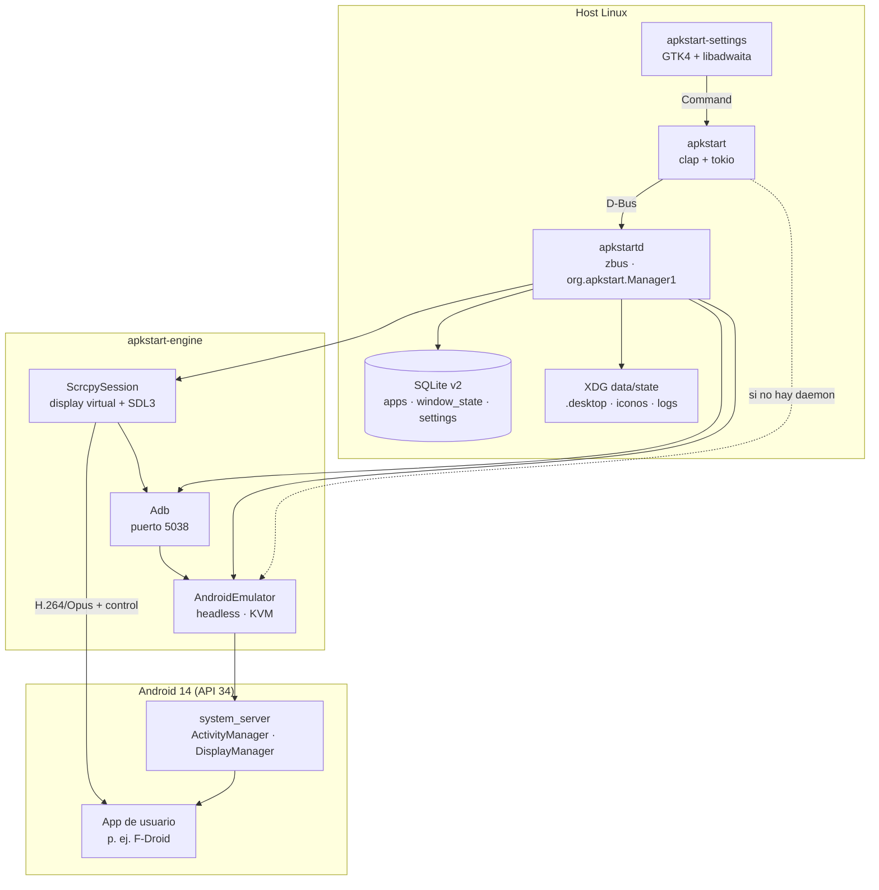
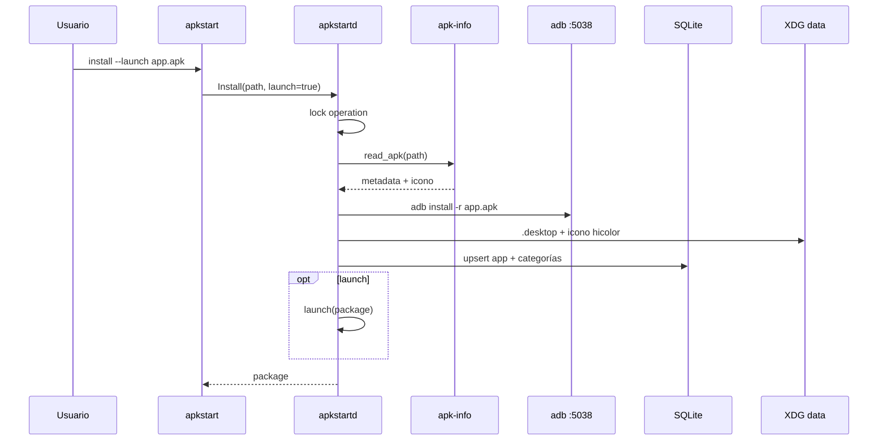

# Arquitectura

Documento técnico del estado real del proyecto. El plan original está en
[`plan-inicial/`](plan-inicial/); esto describe lo implementado y sus límites.

## 1. Objetivo y restricciones

models-apk permite usar aplicaciones Android en un escritorio Linux sin mostrar
el escritorio Android y sin embeber un navegador Electron.

Restricciones de diseño vigentes:

- **Motor fijo del MVP:** Android Emulator oficial + API 34 x86_64
  `google_apis`. QEMU puro, Waydroid y contenedores quedan fuera del MVP.
- **Sin Electron, Node ni Java en el producto host.** Java solo lo usa el SDK
  de Android como herramienta externa.
- **Una ventana Wayland por app**, no una ventana con el escritorio Android.
- **Estabilidad y usabilidad antes que optimización.** Cualquier cambio de motor
  requiere datos y una entrada en la bitácora.
- **La UI no habla con ADB**: delega en el binario `apkstart` y, a través de él,
  en el daemon.

## 2. Vista de componentes



### Crates

| Crate | Responsabilidad | Depende de |
|---|---|---|
| `apkstart-core` | `Config`, `Db`, modelos, `.desktop`, iconos, errores y rutas XDG. | `rusqlite` (bundled), `serde`, `toml`, `png`, `dirs` |
| `apkstart-apk` | Lectura del APK: package, label, versión, activity, SDK, ABIs, permisos, icono. Envuelve `apk-info`. | `apk-info` |
| `apkstart-engine` | `AndroidEmulator` (checks, arranque/parada/estado), `Adb`, `ScrcpySession`. | `apkstart-core`, `tokio` |
| `apkstart-app` | Lógica compartida de install/registro/sync entre CLI y daemon. | `core`, `apk`, `engine`, `tokio` |
| `apkstart-daemon` | `Manager` (runtime, sesiones, install/sync), D-Bus y bucles de sync/limpieza. | `app`, `core`, `engine`, `zbus` |
| `apkstart-cli` | Binario `apkstart`; cliente D-Bus con fallback directo. | `core`, `app`, `engine`, `clap`, `zbus` |
| `apkstart-settings` | UI GTK4/libadwaita; ejecuta `apkstart` para las acciones. | `gtk4`, `libadwaita`, `core` |

El detalle de archivos está en [estructura.md](estructura.md).

## 3. Arranque del runtime

1. El CLI o la UI envía `StartRuntime` al daemon (o llama al motor en modo directo).
2. `Manager` toma el mutex `operation` para serializar install/sync/runtime.
3. `AndroidEmulator::start()`:
   - comprueba `/dev/kvm`, `adb`, `emulator`, AVD y `scrcpy-server`;
   - arranca `emulator -avd <avd> -no-window -gpu <modo> -accel on`;
   - espera `sys.boot_completed=1` con timeout de 180 s;
   - deja el runtime en estado `running`.
4. `apkstartd` mantiene el emulador vivo entre invocaciones del CLI. `runtime stop`
   cierra el emulador y todas las sesiones scrcpy.

El arranque normal **no** usa `-no-snapshot-load`: el primer arranque de un AVD
nuevo es en frío y los siguientes cargan quickboot para conservar datos y apps.
`APKSTART_COLD_BOOT=1` fuerza el arranque en frío para recuperación.

## 4. Instalación de un APK

`apkstart install <ruta>` o el handler MIME de doble clic:



- El parser es `apk-info` (Apache-2.0), no un AXML propio.
- El `.desktop` usa `Categories=` freedesktop calculadas desde `android:appCategory`
  más heurísticas de package/label.
- El icono se guarda en la carpeta hicolor según el tamaño del PNG. Si solo hay
  adaptive icon vectorial, se genera un PNG de respaldo con la inicial.
- `binfmt_misc` permite `./app.apk`; el handler llama a `apkstart install --launch`
  **como el usuario**, nunca como root.

## 5. Lanzamiento de una app y display virtual

1. `Manager::launch(package)` busca una sesión viva en
   `Mutex<HashMap<String, ScrcpySession>>`.
2. Antes de reutilizarla comprueba `/proc/<pid>/cmdline`: debe contener `scrcpy`
   y el serial `emulator-5556`. Si el proceso murió, elimina la entrada.
3. Si no hay sesión, crea `ScrcpyOptions` con:
   - display `552x984/215` (411 dp, ancho de Pixel 6);
   - `--flex-display` para que el display siga el tamaño de la ventana;
   - `--start-app=<package>`, `--display-ime-policy=local`, `--keep-active`,
     `--no-vd-system-decorations`, 60 fps y 8 Mbps;
   - `SDL_APP_ID=io.github.apkstart.<package>`.
4. scrcpy crea un display virtual nuevo, arranca la app en él y abre una ventana
   SDL3/Wayland.
5. `Manager` guarda el `Child` de scrcpy y devuelve su PID.

### Densidad

Android dibuja en **dp**, no en píxeles. La fórmula usada es:

```
dpi = round(ancho_ventana_px × 160 / ancho_dp)
```

Con `--flex-display` el dpi queda fijo y el display cambia de píxeles con la
ventana: al agrandarla crece el ancho lógico (más columnas), no el zoom. El
default `552×984/215` da 411 dp y texto de ~19 px en la ventana inicial.

### Identidad de ventana

`SDL_APP_ID=io.github.apkstart.<package>` hace que SDL3 use ese `app_id` en
Wayland y esa clase en X11. El `.desktop` y `StartupWMClass` usan el mismo valor,
por lo que el compositor asocia icono, menú y agrupación. Sin esta variable todas
las apps compartirían la clase `scrcpy`.

## 6. Sincronización con el escritorio

- `apkstartd` ejecuta un bucle cada **15 s**:
  - si el runtime está online, lista packages `-3` con ADB;
  - extrae el APK base a `~/.local/share/apkstart/cache`;
  - registra apps nuevas, actualiza cambios y elimina entradas de apps
    desinstaladas;
  - `apkstart sync --refresh` fuerza el re-registro de todas.
- Si el daemon no está, `apkstart setup` deja el timer de systemd como respaldo
  y el CLI sincroniza en modo directo (`--if-running --quiet`).
- Un limpiador cada **5 s** retira sesiones scrcpy cuyo PID ya no existe (por
  ejemplo, al cerrar la ventana a mano).

## 7. D-Bus

Servicio de sesión `org.apkstart.Manager1`, objeto `/org/apkstart/Manager1`.

| Método | Entrada | Salida |
|---|---|---|
| `GetVersion` | — | versión del daemon |
| `GetRuntimeStatus` | — | `RuntimeStatus` en JSON |
| `StartRuntime` / `StopRuntime` | — | `RuntimeStatus` en JSON |
| `ListApps` | — | array de `App` en JSON |
| `Install` | `path: String`, `launch: bool` | package instalado |
| `Sync` | `refresh: bool` | `(added, removed)` |
| `Launch` | `package: String` | PID de scrcpy |
| `StopApp` | `package: String` | `bool` (existía) |

La activación D-Bus está en `packaging/dbus/org.apkstart.Manager1.service.in`.
El servicio de systemd es de usuario (`apkstartd.service`) y entra en
`models-apk.slice` para agrupar CPU/RAM/IO.

## 8. Persistencia y rutas

| Ruta | Contenido |
|---|---|
| `~/.config/apkstart/config.toml` | Configuración opcional (TOML). |
| `~/.local/share/apkstart/apkstart.db` | SQLite con apps, ventanas y settings. |
| `~/.local/share/apkstart/cache/` | APK base extraídos para iconos/metadata. |
| `~/.local/share/applications/` | Entradas `.desktop` de apps y del handler APK. |
| `~/.local/share/icons/hicolor/<tamaño>/apps/` | Iconos por app. |
| `~/.local/state/apkstart/emulator.log` | Log del emulador. |
| `~/.local/state/apkstart/sessions/<package>.log` | Log de scrcpy por app. |

Esquema SQLite actual: `PRAGMA user_version = 2` con tablas `apps`,
`window_state` y `settings`. La tabla `sessions` (v3) para persistir sesiones
scrcpy y adoptarlas tras reiniciar el daemon **aún no existe**.

## 9. Concurrencia

- `Manager.operation: tokio::sync::Mutex<()>` serializa `StartRuntime`,
  `StopRuntime`, `Install` y `Sync` (operaciones largas).
- `Manager.sessions: tokio::sync::Mutex<HashMap<...>>` protege el mapa de
  sesiones.
- `launch` **no** toma `operation`; comprueba el mapa, suelta el lock y luego
  lanza scrcpy. Esto deja una ventana de carrera: dos llamadas simultáneas al
  mismo package pueden crear dos procesos scrcpy. Es una causa plausible del bug
  de “ventana negra” descrito en [bugs.md](bugs.md); la corrección pendiente es
  mantener un lock por package durante todo el spawn o insertar un placeholder.
- `apkstart-app` usa locks de install/sync propios para que CLI y daemon no
  dupliquen trabajo.

## 10. Límites conocidos de la arquitectura

- **scrcpy es el visor del MVP.** Un visor propio (`apkstart-viewer`) queda para
  Fase 3; permitiría persistir tamaño/posición y controlar el foco.
- **Un solo emulador y un solo AVD.** No hay aislamiento por app ni multi-tenant.
- **Sin adopción de sesiones tras reiniciar el daemon.** Si `apkstartd` muere,
  los scrcpy hijos siguen vivos pero el daemon los pierde.
- **GPU global, no por proceso.** El kernel no atribuye uso de GPU a un PID; la
  UI muestra el agregado de sysfs.
- **NAT de slirp.** LAN, mDNS y Chromecast no son transparentes; proxy/DNS/puertos
  avanzados son Fase 4.
- **Emulador x86_64.** Apps con binarios ARM-only no arrancan; DRM/Play Integrity
  y anticheat pueden fallar.
