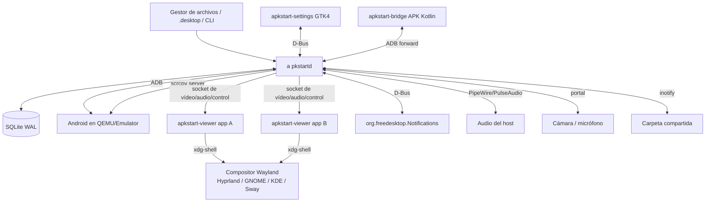

# 01 — Arquitectura

## 1. Principios

1. **Un solo daemon de usuario** controla el runtime Android, las apps y la integración. Las ventanas y la UI no hablan con ADB directamente.
2. **Cada app es una ventana Wayland estándar**, no un escritorio Android dentro de otra ventana.
3. **El host manda en la experiencia**: red, audio, portapapeles, notificaciones, archivos y periféricos se configuran desde Linux; Android no muestra sus ajustes al usuario.
4. **Aislamiento por proceso**: un fallo del viewer no tumba el daemon ni el runtime; un fallo de una app no tumba las demás.
5. **Nada propietario en el repositorio**: imágenes de Android, emulador y bins de Google se descargan por el usuario y se aceptan sus licencias.
6. **Recuperación antes que perfección**: si el display virtual falla, la app debe poder abrirse en un modo de compatibilidad de una sola ventana; si el motor no arranca, se muestra un diagnóstico accionable.

---

## 2. Diagrama de componentes



---

## 3. Componentes

### 3.1 `apkstartd` — daemon

Proceso Rust de usuario, arrancado por D-Bus o por `systemd --user`.

Responsabilidades:

- Ciclo de vida del motor Android: comprobar KVM, descargar/verificar runtime, crear AVD, arrancar, parar, snapshot, watchdog.
- Gestión de apps: instalar, desinstalar, listar, lanzar, parar, limpiar datos.
- Crear displays virtuales y sesiones de scrcpy.
- Lanzar y supervisar `apkstart-viewer`.
- Persistir ajustes, apps, ventanas y estado.
- Puente de notificaciones, portapapeles, archivos, red y periféricos.
- Exponer D-Bus y un socket local para viewers.
- Diagnóstico, logs y recuperación.

No debe:

- Renderizar UI.
- Bloquearse esperando a un viewer.
- Ejecutar código de las apps en el host.

### 3.2 `apkstart` — CLI

Comandos:

```text
apkstart install <archivo.apk|.apks|.xapk>
apkstart launch <paquete> [--size 900x1600] [--fullscreen]
apkstart list [--json]
apkstart uninstall <paquete> [--keep-data]
apkstart settings
apkstart doctor
apkstart export-log
```

Los `.desktop` de cada app ejecutan `apkstart launch <paquete>`.

### 3.3 `apkstart-settings` — interfaz de ajustes

GTK4 + libadwaita. Es la **única** interfaz de administración visible:

- Runtime y almacenamiento.
- Apps instaladas.
- Red.
- Periféricos.
- Integración con el escritorio.
- Diagnóstico y actualizaciones.
- Preferencias por app (tamaño, orientación, permisos, datos).

No hay un “launcher” de apps separado. Las apps se abren desde sus `.desktop`, desde el menú del compositor o desde la lista de apps de ajustes.

### 3.4 `apkstart-viewer` — ventana de app

Un proceso por ventana de app. Decide el diseño final tras el spike:

- **Opción A (MVP rápido):** wrapper sobre `scrcpy` con opciones de ventana y un protocolo de control mínimo.
- **Opción B (recomendada a medio plazo):** viewer Rust propio que habla el protocolo de scrcpy.

Responsabilidades:

- Crear una ventana `xdg-toplevel` con `app_id` único y título de la app.
- Decodificar vídeo H.264/H.265/AV1 con VA-API o fallback software.
- Renderizar en un `GtkGLArea` o sink equivalente.
- Enviar eventos de entrada y portapapeles al display virtual.
- Reportar tamaño/estado de ventana al daemon.
- Cerrar la sesión y destruir el display virtual al cerrar.
- Mostrar errores claros (app cerrada, display perdido, DRM no capturable).

### 3.5 `apkstart-bridge` — APK auxiliar Android

APK Kotlin que se instala una vez en la imagen del usuario (no en el host).

Responsabilidades:

- `NotificationListenerService` para reenviar notificaciones.
- Acciones de notificación (abrir, descartar, responder si es posible).
- Puente de portapapeles cuando scrcpy no sea suficiente.
- Exponer archivos del host mediante un `DocumentsProvider` o un `ContentProvider` (fase 2).
- Recibir intents del host: abrir URL, compartir archivo, abrir app.
- Opcional: métricas de display/sesión y control de orientación.

No es root. Se instala con `adb install` y se le conceden permisos de listener con comandos de shell estándar.

### 3.6 Motor Android

Interfaz `Engine` con implementaciones:

- `AndroidEmulatorEngine` (MVP).
- `QemuEngine` (fase 2).
- `WaydroidEngine` (opcional futuro; no cumple el requisito QEMU).

La interfaz debe abstraer:

```rust
trait Engine {
    fn id(&self) -> EngineId;
    async fn check(&self) -> EngineStatus;
    async fn ensure(&self, opts: &RuntimeOptions) -> Result<Runtime>;
    async fn shutdown(&self, mode: ShutdownMode) -> Result<()>;
    async fn adb(&self) -> Result<AdbClient>;
    fn capabilities(&self) -> Capabilities;
}
```

`Capabilities` incluye: displays virtuales, snapshot, GPU, audio, cámara, ARM, GMS.

---

## 4. Stack técnico

| Capa | Elección | Motivo |
|---|---|---|
| Daemon | Rust + tokio | Seguridad de memoria, async, procesos, señales, sockets |
| D-Bus | zbus | API de escritorio estándar; sin dependencias pesadas |
| UI ajustes | GTK4 + libadwaita | Nativa, Wayland, accesible; funciona en GNOME/KDE/Hyprland |
| Viewer | GTK4 + GStreamer / libmpv | Ventana xdg-shell, decodificación VA-API, GL area |
| Vídeo | GStreamer (`vah264dec`, `vah265dec`, `av1dec`) | Hardware decode y sinks DMA-BUF |
| APK | crates `zip`, `quick-xml`/AXML propio, `image` | Sin Java/aapt en el host |
| DB | `rusqlite` + WAL | Simple, transaccional, fácil de inspeccionar |
| Config | TOML | Legible y versionable |
| Notificaciones | `notify-rust` / D-Bus | Integración freedesktop |
| Audio | PipeWire/PulseAudio (QEMU) | Compartido con el host |
| Empaquetado | systemd user unit + AppImage/deb/rpm/Arch; Flatpak fase 2 | Distribución realista |

### ¿Por qué Rust y no C++/Qt?

- Rust elimina clases enteras de bugs en el parser de APK y en la gestión de procesos.
- `tokio`, `zbus`, `rusqlite` y los bindings GTK4 están maduros.
- GTK4 es la opción más neutra entre GNOME, KDE y wlroots; Qt6 sería más natural en KDE, pero añade C++ y una dependencia más pesada.
- Si el equipo es C++/Qt, la arquitectura se mantiene; solo cambia la implementación del host.

### ¿Por qué no Electron?

- El requisito lo prohíbe y además el coste de memoria/arranque no encaja con un daemon de sistema.
- La UI es pequeña; GTK4 sobra.
- El viewer necesita GL/VA-API y control fino de ventanas; Electron no es la herramienta adecuada.

---

## 5. Estructura del workspace

```text
apkstart-linux/
├─ Cargo.toml                 # workspace
├─ crates/
│  ├─ apkstart-core/          # tipos, errores, configuración, DB
│  ├─ apkstart-apk/           # ZIP, AXML, ARSC, iconos, manifiesto
│  ├─ apkstart-engine/        # trait Engine, Emulator, QEMU, ADB
│  ├─ apkstart-scrcpy/        # protocolo scrcpy, server, sesiones
│  ├─ apkstart-daemon/        # binario apkstartd
│  ├─ apkstart-cli/           # binario apkstart
│  ├─ apkstart-viewer/        # binario apkstart-viewer
│  ├─ apkstart-settings/      # binario apkstart-settings
│  └─ apkstart-integration/   # red, audio, notificaciones, archivos
├─ android/bridge/            # APK Kotlin (Gradle)
├─ data/
│  ├─ icons/                  # iconos extraídos
│  └─ schemas/                # SQL migrations
├─ packaging/
│  ├─ apkstartd.service       # systemd --user
│  ├─ apkstart.desktop        # ajustes
│  ├─ mime/apkstart.xml       # asociación .apk
│  └─ flatpak/                # fase 2
├─ tests/
│  ├─ fixtures/               # APKs de prueba con licencia compatible
│  └─ integration/            # scripts con emulador
└─ docs/
```

---

## 6. API D-Bus

Servicio: `org.apkstart.Manager1` en la sesión del usuario.

```text
Install(s path) -> (s package)
InstallBundle(s path) -> (s package)
Uninstall(s package, b keep_data)
Launch(s package, a{sv} options) -> (s session_id)
Stop(s package)
ListApps() -> a(sssssb)          # package, label, version, activity, icon, running
GetApp(s package) -> a{sv}
GetRuntimeStatus() -> a{sv}
GetSettings() -> a{sv}
UpdateSettings(a{sv} patch)
SetWindowState(s package, i width, i height, b maximized, b fullscreen)
ResetWindowState(s package)
OpenAndroidSettings()            # escape hatch avanzado
ExportDiagnostics() -> (s path)
```

Señales:

```text
InstallProgress(s package, s stage, u percent, s message)
AppChanged(s package)
RuntimeChanged(s state, s message)
Notification(s app, s title, s body, s icon)
Error(s code, s message, s details)
```

Los viewers no usan D-Bus para el vídeo: el daemon les pasa un socket Unix y un token de sesión efímero.

---

## 7. Modelo de datos

### `apps`

| Campo | Tipo | Nota |
|---|---|---|
| `package` | TEXT PK | nombre Android validado |
| `label` | TEXT | nombre visible |
| `version_name` | TEXT | |
| `version_code` | INTEGER | |
| `activity` | TEXT | componente resuelto por Android |
| `icon_path` | TEXT | PNG en `~/.local/share/icons/hicolor/...` |
| `apk_path` | TEXT | copia de seguridad |
| `bundle` | INTEGER | APK simple o split |
| `min_sdk` | INTEGER | |
| `abis` | TEXT | JSON |
| `orientation` | TEXT | portrait/landscape/null |
| `signer` | TEXT | hash del certificado |
| `installed_at` | INTEGER | |
| `last_launched_at` | INTEGER | |
| `enabled` | INTEGER | |

### `window_state`

| Campo | Tipo | Nota |
|---|---|---|
| `package` | TEXT PK | |
| `width` | INTEGER | tamaño lógico |
| `height` | INTEGER | |
| `maximized` | INTEGER | |
| `fullscreen` | INTEGER | |
| `output` | TEXT | nombre del monitor, si se conoce |
| `scale` | REAL | escala del monitor |
| `updated_at` | INTEGER | |

No se guarda `x/y` en Wayland. En X11/XWayland se puede añadir `x`, `y` como opcionales.

### `sessions`

| Campo | Tipo |
|---|---|
| `id` | TEXT PK |
| `package` | TEXT |
| `display_id` | INTEGER |
| `viewer_pid` | INTEGER |
| `state` | TEXT |
| `started_at` | INTEGER |

### `sync_state`

`path`, `size`, `mtime_host`, `mtime_guest`, `hash`, `side`, `tombstone`, `conflict_copy`.

### `settings`

Clave/valor JSON versionado; migraciones SQL. Secretos (proxy, tokens) en `libsecret`/Secret Service, no en SQLite.

---

## 8. Ciclo de vida

### Arranque

1. El usuario abre un `.desktop` o un APK.
2. El CLI llama al daemon por D-Bus; si no está, systemd lo activa.
3. El daemon comprueba KVM, runtime, imagen y ADB.
4. Si es la primera vez, lanza el wizard de ajustes; no bloquea la app si el runtime no está listo.
5. Arranca el motor headless y espera `sys.boot_completed` + `pm path android`.
6. Crea el display virtual y lanza la app.
7. Arranca el viewer; le pasa el socket y el estado de ventana.

### Apertura de una app

1. Resolver activity con `cmd package resolve-activity --brief`.
2. Si la app ya tiene una sesión viva, enfocar su ventana.
3. Si no, crear display virtual con tamaño/DPI guardados.
4. `am start --display <id> --activity-clear-top -n pkg/activity`.
5. Esperar a que el proceso exista (`pidof`), con timeout y logcat.
6. Iniciar scrcpy server para ese display.
7. Viewer muestra el primer frame; si no llega, reintentar/reportar.

### Cierre

1. El usuario cierra la ventana.
2. Viewer pide al daemon cerrar la sesión.
3. El daemon destruye el display virtual (por defecto) y hace `am force-stop` si el ajuste “cerrar app al cerrar ventana” está activo.
4. Si se guarda en segundo plano, la app se mueve al display principal o se deja viva con límite; se documenta.
5. Si no quedan ventanas, se programa snapshot/cierre por inactividad.

### Fallos

- Motor caído: reiniciar con backoff; no reiniciar en bucle infinito.
- ADB offline: matar servidor ADB propio y reintentar; no tocar el ADB del usuario.
- Viewer caído: el daemon cierra la sesión y deja la app en segundo plano.
- App crash: mostrar diálogo con logcat resumido y opción “reiniciar”, “limpiar datos”, “abrir ajustes”.
- Disco lleno: pausar instalaciones y avisar antes de llenar.

---

## 9. Concurrencia y límites

- Un runtime Android por usuario (no uno por app).
- Varios displays virtuales, límite configurable (por defecto 3).
- Cola de instalación de una sola operación; no instalar dos APKs a la vez.
- Cola de arranque: una app a la vez hasta que el runtime esté listo.
- Presión de memoria: cerrar la app menos usada; nunca el runtime si hay ventanas activas.
- cgroups v2 para el proceso QEMU (CPU/IO), no por app.
- Timeouts en todas las llamadas ADB; reintentos con backoff.
- Logs rotativos por sesión; no bloquear el daemon por escritura de logs.

---

## 10. Seguridad

- Todo corre como el usuario; nunca root.
- KVM: comprobar `/dev/kvm` y permisos; si no, modo TCG lento con aviso.
- Imágenes y runtime: descarga HTTPS + SHA-256 + firma del manifiesto; no aceptar mirrors sin verificación.
- APK: Android verifica la firma al instalar; el host muestra el firmante y los permisos.
- Zip-slip y nombres maliciosos: validar en el parser y en el instalador.
- Permisos Android: **no** conceder automáticamente por defecto; toggle explícito.
- Secretos: `libsecret`; nunca en logs.
- Datos: 0700; carpeta compartida opt-in; portapapeles opt-in.
- DRM/secure: no intentar saltar `FLAG_SECURE`; mostrar mensaje y ofrecer modo alternativo si existe.
- Actualizaciones: paquetes firmados; verificación antes de ejecutar.

---

## 11. Observabilidad

- `tracing` con spans por sesión y app; logs rotativos.
- Comando `apkstart doctor`:
  - KVM, CPU, GPU, VA-API, PipeWire, Wayland, compositor, ADB, runtime, imagen, espacio.
- Exportar diagnóstico en `.tar.zst` con logs redactados.
- Estado en ajustes: runtime, app, display, latencia, memoria, disco.
- Nunca enviar telemetría por defecto.

---

## 12. Empaquetado

- **systemd --user**: `apkstartd.service`, activación por D-Bus.
- **.desktop**:
  - `apkstart-settings.desktop` para ajustes.
  - `apkstart-<pkg>.desktop` por app.
- **MIME**: `application/vnd.android.package-archive` → `apkstart install %f`.
- **Iconos**: `hicolor` por tamaños; `gtk-update-icon-cache` o `xdg-icon-resource`.
- **AppImage** para prueba; **deb/rpm/Arch** para distribución; **Flatpak** solo si se resuelven KVM/ADB/USB con portals.
- **Sin Electron, sin Node, sin Java en el host**; el bridge Kotlin es solo un APK dentro de Android.
